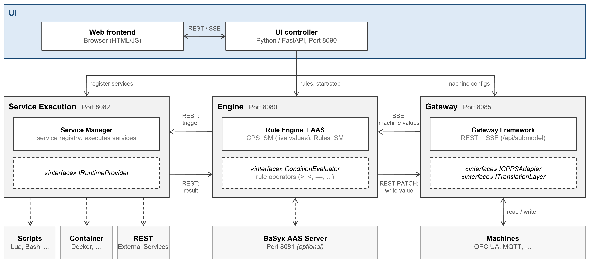

<!-- Include project logo -->

  

# LABraDT: The Rapid Application Development Toolkit for Digital Twins

LABraDT is an open-source framework for developing modular asset administration shell (AAS)-based digital twin applications with reusable components and abstracted cyber-physical production systems (CPPS) connectivity.

## Table of Contents

- [Why LABraDT?](#why-labradt)
- [Getting Started](#getting-started)
  - [Architecture](#architecture) 
  - [Repository Overview](#repository-overview)
  - [How to Build](#how-to-build)
  - [Quick Start](#quick-start)

## Why LABraDT?

Digital twins are becoming an increasingly important technology for understanding, designing, operating, and managing cyber-physical production systems. 
By connecting directly to a physical production system, a digital twin can automatically collect and process data, perform analyses and calculations, and send instructions back to the system. 
This creates a digital abstraction of the physical system, standardizes interfaces, and enables services and solutions to be reused across different applications.

However, developing digital twins remains a significant engineering challenge, as there is still no systematic approach for their development. 
In practice, digital twin applications are often built as purpose-specific solutions, requiring substantial development effort for each individual use case. 
This not only increases development costs but also limits the reusability that digital twins are intended to provide.

LABraDT addresses these challenges through a component-based approach that separates application logic from the underlying production-system connectivity.

With LABraDT, developers can:

- **Develop AAS-based applications** combining asset models and associated services.
- **Reuse software components** instead of implementing every application from scratch.
- **Abstract CPPS connectivity** to reduce coupling between application logic and specific production systems.
- **Prototype faster** by combining reusable components and configuring workflows.
- **Deploy, test and validate services** in a controlled environment.

## Getting Started

> **_Release Note (v0.9):_** LABraDT is currently available as pre-release. The software is still under active development. Functionality, interfaces and documentation may change in future versions. Some features may be incomplete or subject to change. We welcome feedback, bug reports and contributions to help improve the framework.

### Architecture

LABraDT follows a modular, service-oriented architecture. 
The LABraDT Core consisting of four main components: UI, Service Execution, Engine and Gateway. 
Each component encapsulates specific functionality and communicates with the others through defined interfaces and standardized communication mechanisms.

<!-- Include architecture overview -->

  

#### LABraDT UI 

The UI provides the graphical user interface for configuring and operating LABraDT. 
It consists of a web frontend (HTML/JavaScript), which communicates with a Python-based UI controller implemented using FastAPI. 
Communication is handled via REST and Server-Sent Events (SSE). 
The UI controller coordinates service registration, rule configuration, engine operation (start/stop) and machine configuration.

#### LABraDT Runtime

The Runtime component manages and executes external services. 
Its Service Manager provides a service registry and handles service invocation. 
The component supports different execution environments through the IRuntimeProvider interface, including scripts, containerized applications and external services accessible.
Services are triggered by the Engine and return their results through REST interfaces.

#### LABraDT Engine

The Engine provides the central logic for executing rules and interacting with AAS-based data models. 
Its Rule Engine integrates the AAS submodels CPS_SM (providing live values) and Rules_SM (containing rule definitions). 
The ConditionEvaluator interface enables the evaluation of rule conditions using configurable operators.
The Engine communicates with the Gateway to retrieve live machine values and write updated values. 
An optional BaSyx AAS Server can be connected to provide AAS infrastructure.

####  LABraDT Gateway

The Gateway abstracts connectivity to physical machines and production systems. 
Its Gateway Framework provides REST and SSE interfaces for accessing AAS submodels and exchanging machine data. 
The interfaces ICPPSAdapter and ITranslationLayer decouple the framework from specific communication protocols and production system implementations. 
This enables connectivity to different machines and communication technologies.

#### LABraDT Plugins

The core functionality can be extended through plugins, with additional plugins currently under development.

### Repository Overview

The repositories are structured into the LABraDT Core, that implements required components that are included in every build, and optional components, implemented in Plugins.

#### LABraDT Core

The following repositories build the LABraDT Core:
- [LABraDT-core-UI](https://github.com/LABraDT-Framework/LABraDT-core-UI)
- [LABraDT-core-Runtime](https://github.com/LABraDT-Framework/LABraDT-core-Runtime)
- [LABraDT-core-Engine](https://github.com/LABraDT-Framework/LABraDT-core-Engine)
- [LABraDT-core-Gateway](https://github.com/LABraDT-Framework/LABraDT-core-Gateway)

#### LABraDT Plugins

The following repositories implement service runtimes to extend the LABraDT Core:
<!-- - [LABraDT-plugin-Docker](https://github.com/LABraDT-Framework/LABraDT-plugin-Docker) -->
- [LABraDT-plugin-Python](https://github.com/LABraDT-Framework/LABraDT-plugin-Python)
- [LABraDT-plugin-Lua](https://github.com/LABraDT-Framework/LABraDT-plugin-Lua)
- [LABraDT-plugin-REST](https://github.com/LABraDT-Framework/LABraDT-plugin-REST)
- [LABraDT-plugin-Bash](https://github.com/LABraDT-Framework/LABraDT-plugin-Bash)

The following repositories implement gateways to establish CPS connections:
- [LABraDT-plugin-MQTT](https://github.com/LABraDT-Framework/LABraDT-plugin-MQTT)
- [LABraDT-plugin-OPCUA {private}](https://github.com/LABraDT-Framework/LABraDT-plugin-OPCUA)

<!-- 
#### LABraDT SDK 

The following repositories implement SDKs with LABraDT-specific functions for service development:
- [LABraDT-sdk-Python](https://github.com/LABraDT-Framework/LABraDT-sdk-Python)
- [LABraDT-sdk-Lua](https://github.com/LABraDT-Framework/LABraDT-sdk-Lua)

-->

<!-- #### LABraDT Services

The following repositories provide service to be used within LABraDT:
- [LABraDT-service-xxx]()
-->

### How to Build

LABraDT is built from the [LABraDT-core-UI](https://github.com/LABraDT-Framework/LABraDT-core-UI) repository. 
This repository serves as the central entry point for building LABraDT and contains links to all other required core components.

#### Dependencies

|Product|Recommended Version|
|---|---|
| Java | JDK 21 | 
| Python | Python 3.12 | 
| Maven | Maven 3.8  |

#### Next Steps
Clone the repository and follow the build instructions within the repository. 
Ensure that all required components are available and properly linked before initiating the build.

### Quick Start

> **_Release Note (v0.9):_** LABraDT is currently available as pre-release. The software is still under active development. Functionality, interfaces and documentation may change in future versions. Some features may be incomplete or subject to change. We welcome feedback, bug reports and contributions to help improve the framework.

A complete build of LABraDT, including LABraDT Core and all available plugins, will be provided with the first stable release.
For this pre-release, you will need to build the projects yourself. See [How to Build](#how-to-build) for instructions.

<!-- The [Download](https://github.com/orgs/LABraDT-Framework/packages) does provide a full build of LABraDT, including the LABraDT Core and all available Plugins. 

Include how to get a container running -->

